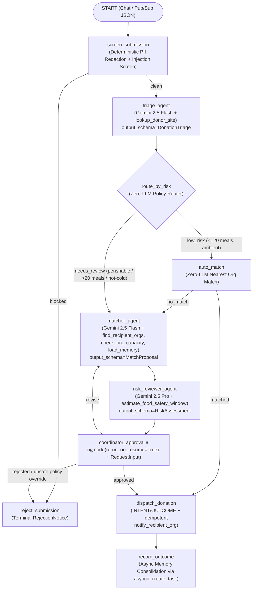

# The Good Neighbour

> **Open-source AI dispatch for surplus food.**
> Built on **Google Agent Development Kit (ADK 2.0)** with **Gemini 2.5 Flash & Pro**, deterministic policy routing, and a human-in-the-loop safety gate.

[](LICENSE)

---

## 1. Why This Exists

**Toronto food banks logged a record 4.1M visits (Apr 2024–Mar 2025, *Who's Hungry 2025*), while downtown kitchens throw out edible food ~1.5 km from the drop-ins that need it.** The gap isn't supply. It's the match. Scheduled pallets move fine, but a perishable lot like `"55 hot trays at MTCC South, must move within 2 hours"` often spoils while someone reads the text, checks fridge space, works out a safe holding window, and phones around.

**The design principle: code owns the rules, Gemini handles language and judgment, and people make the final call.**

| | Small, shelf-stable lot | Perishable or large lot |
|---|---|---|
| **Path** | Screen → Gemini Flash reads it → code routes → auto-match → dispatch | Screen → Flash reads it → code routes → Flash matches → **Gemini Pro safety review** → **human approval** → dispatch |
| **Model calls after intake** | None | Two (Flash and Pro) |
| **Target time to match** | Under 10 minutes | Under 45 minutes |

**The Good Neighbour** is open, vendor-neutral agent infrastructure that a Business Improvement Area (BIA), venue group, or drop-in network can run. A 90-day Downtown Toronto pilot is proposed in the companion deck (*The Good Neighbour: Downtown Toronto Pilot*). The six workflow stages:

1. **Pre-LLM Security Screen (`screen_submission`)** — Deterministically scrubs PII (`EMAIL`, `PHONE`, `CARD`, `GOV_ID`, `POSTAL_CODE`) and blocks prompt-injection heuristics *before* any model call.
2. **Structured Triage (`triage_agent`, Gemini 2.5 Flash)** — Normalizes messy donor text or Pub/Sub JSON into a strict `DonationTriage` schema and resolves landmark venues via `lookup_donor_site`.
3. **Zero-Token Policy Router (`route_by_risk`)** — Pure Python policy routes small, ambient, non-perishable lots (`<= 20` meals) to a **zero-LLM fast path** (`auto_match` → `dispatch_donation`), saving 100% of downstream model tokens and coordinator time.
4. **Specialist Matching & Safety Review (`matcher_agent` on Flash → `risk_reviewer_agent` on Pro)** — Perishable, temperature-controlled, or large lots are matched against nearby recipient capacity/refrigeration (`find_recipient_orgs`, `check_org_capacity`, `load_memory`) and evaluated by **Gemini 2.5 Pro** (`estimate_food_safety_window`) for time/temperature hazards.
5. **Human-in-the-Loop Hard Stop (`coordinator_approval`)** — Uses ADK 2.0 `RequestInput` (`@node(rerun_on_resume=True)`) to pause the workflow for a coordinator (`approve`, `revise`, or `reject`) and **policy-refuses** approval if the risk reviewer flagged the lot as `unsafe`.
6. **Idempotent Dispatch & Async Memory (`dispatch_donation` → `record_outcome`)** — Captures structured `INTENT` before and `OUTCOME` after notifying the recipient, then persists the dispatch to long-term memory asynchronously via `asyncio.create_task` without blocking the turn.

> **Disclaimer:** *The Good Neighbour* is an independent open-source reference project. It is **not affiliated with or endorsed by Second Harvest, Daily Bread Food Bank, or any other charity**. Recipient organizations in [`data/recipient_orgs.json`](data/recipient_orgs.json) are **fictional composite sites** placed in real Downtown Toronto neighbourhoods for demonstration and testing.

---

## 2. Architecture



---

## 3. Repository Layout

```text
good-neighbour/
├── good_neighbour/
│   ├── __init__.py          # Exports `agent` for `adk web` / `adk run` / `adk eval`
│   ├── agent.py             # ADK 2.0 `Workflow` graph (`root_agent`) + resumable/compacting `App` (`app`)
│   ├── agents.py            # Specialist LlmAgents (Flash triage & matcher, Pro risk reviewer)
│   ├── callbacks.py         # before_model_callback guardrail + before/after/error tool callbacks
│   ├── config.py            # Central tunables, model routing, enterprise mode detection
│   ├── guardrails.py        # Regex PII redactor (`redact_pii`), injection scanner, logging filter
│   ├── nodes.py             # Deterministic graph nodes, HITL gate, async memory writer
│   ├── observability.py     # JSON logging (`python-json-logger`) + OpenTelemetry tracing + INTENT/OUTCOME
│   ├── schemas.py           # Strict Pydantic v2 schemas (`extra="forbid"`) for tools & agent outputs
│   ├── secrets.py           # Env -> Google Cloud Secret Manager secret hydration (`hydrate_model_credentials`)
│   ├── services.py          # Session (`DatabaseSessionService` / Vertex) & Memory service wiring
│   ├── tools.py             # Deterministic tools with Google-style docstrings & guided `ToolError` recovery
│   └── prompts/             # Markdown system-instruction constitutions (`triage.md`, `matcher.md`, `risk_reviewer.md`)
├── data/
│   ├── donor_sites.json         # Downtown Toronto landmark donor venues & coordinates
│   ├── recipient_orgs.json      # 12 fictional Downtown Toronto recipient organizations
│   └── sample_submissions.json  # Ambient event payloads for simulator & local demos
├── eval/
│   ├── good_neighbour.evalset.json  # 8-case golden evaluation dataset (`EvalSet`)
│   └── eval_config.json             # Trajectory & response match thresholds
├── push_endpoint/
│   ├── main.py              # Optional FastAPI Cloud Run Pub/Sub push receiver + `/sessions/{id}/resume`
│   └── Dockerfile           # Non-root production container image
├── scripts/
│   ├── run_local.py         # Interactive CLI supporting the HITL coordinator approval loop
│   └── pubsub_simulator.py  # Replays `sample_submissions.json` locally or publishes to Cloud Pub/Sub
├── terraform/
│   ├── main.tf              # Least-privilege SA, APIs, Secret Manager, Pub/Sub, staging bucket, optional Cloud Run
│   ├── variables.tf
│   ├── outputs.tf
│   └── terraform.tfvars.example
├── tests/                   # 42 offline unit & full-graph tests + 1 live integration eval test
├── docs/
│   └── VIDEO_SCRIPT.md      # 3-minute walkthrough script mapped to the 5 rubric categories
└── RUBRIC.md                # Line-by-line traceability matrix for the 19-row AgentOps rubric (95 pts)
```

---

## 4. Quickstart

### Prerequisites
* Python `>= 3.11` and [`uv`](https://docs.astral.sh/uv/)
* Either a **Google AI Studio API key** (`GOOGLE_API_KEY`) or a **Google Cloud project with Vertex AI** enabled

### Install

```bash
uv venv --python 3.12 .venv
source .venv/bin/activate
uv pip install -e ".[dev,server]"
cp .env.example good_neighbour/.env
```

### Mode A — Local with Google AI Studio (fastest)

Edit `good_neighbour/.env`:

```dotenv
GOOGLE_GENAI_USE_ENTERPRISE=FALSE
GOOGLE_API_KEY=your-ai-studio-key
GN_TRACE_EXPORTER=console
```

### Mode B — Enterprise with Vertex AI (`agents-cli` / ADC)

```bash
# Bootstrap GCP auth and Agent Starter Pack / agents-cli tooling:
uvx google-agents-cli setup

gcloud auth application-default login
```

Edit `good_neighbour/.env`:

```dotenv
GOOGLE_GENAI_USE_ENTERPRISE=TRUE
GOOGLE_CLOUD_PROJECT=your-gcp-project-id
GOOGLE_CLOUD_LOCATION=us-central1
# Optional — switches local SQLite to Vertex AI Agent Engine Sessions + Memory Bank:
# AGENT_ENGINE_ID=1234567890
```

### Run Interactive Web UI (`adk web`)

```bash
# Persist sessions in local SQLite across restarts:
adk web --session_service_uri="sqlite+aiosqlite:///./good_neighbour_sessions.db" .
```

### Run Interactive CLI (with Human-in-the-Loop Approval Prompt)

```bash
# Low-risk fast path (auto-dispatches with zero downstream LLM calls):
python scripts/run_local.py "12 loaves of sourdough bread at First Canadian Place food court, ambient"

# Perishable lot (runs matcher on Flash + risk reviewer on Pro, then pauses for coordinator approval):
python scripts/run_local.py "55 hot trays of braised beef and rice at MTCC South Building prepared 1 hour ago"
```

### Run Ambient Pub/Sub Simulator

```bash
# Replay all 5 sample Downtown Toronto events locally (including an adversarial injection test):
python scripts/pubsub_simulator.py --local
```

---

## 5. Testing & Evaluation

### Offline Unit & Full-Graph Tests (`pytest`)

All 42 unit and graph-level tests run **100% offline** in `< 2s` by swapping the three LLM specialists for deterministic function stubs while exercising the real `Workflow` edges, guardrails, tools, HITL checkpoint/resume, and SQLite persistence:

```bash
pytest -q
```

### Golden Evaluation Suite (`adk eval`)

Validate against the 8-case golden dataset in [`eval/good_neighbour.evalset.json`](eval/good_neighbour.evalset.json):

```bash
adk eval good_neighbour eval/good_neighbour.evalset.json \
  --config_file_path eval/eval_config.json \
  --print_detailed_results
```

---

## 6. Cloud Deployment (Terraform + Vertex AI Agent Runtime)

### Step 1 — Provision Cloud Infrastructure with Terraform

```bash
cd terraform
cp terraform.tfvars.example terraform.tfvars
# Edit terraform.tfvars with your project_id
terraform init
terraform apply
```

This provisions:
* Required APIs (`aiplatform`, `cloudtrace`, `logging`, `pubsub`, `run`, `secretmanager`, `storage`)
* Least-privilege runtime service account (`roles/aiplatform.user`, `roles/cloudtrace.agent`, `roles/logging.logWriter`, `roles/pubsub.subscriber`, plus scoped Secret Manager & staging bucket access)
* Secret Manager secret `GOOGLE_API_KEY` (used when running in hybrid mode; Vertex mode uses ADC)
* Pub/Sub intake topic (`good-neighbour-intake`) and Agent Engine staging bucket
* Optional Cloud Run push endpoint + OIDC push subscription (`enable_push_endpoint = true`)

### Step 2 — Deploy to Vertex AI Agent Engine (`adk deploy` / `agents-cli`)

```bash
adk deploy agent_engine \
  --project="$GOOGLE_CLOUD_PROJECT" \
  --region="us-central1" \
  --staging_bucket="gs://${GOOGLE_CLOUD_PROJECT}-good-neighbour-staging" \
  --display_name="The Good Neighbour" \
  good_neighbour
```

Copy the resulting `reasoningEngines/<AGENT_ENGINE_ID>` into `good_neighbour/.env` (or `terraform.tfvars`) to enable managed **Vertex AI Agent Engine Sessions** and **Vertex AI Memory Bank**.

---

## 7. AgentOps Code Review Matrix — Summary Traceability

See [**`RUBRIC.md`**](RUBRIC.md) for the complete 19-row, 95-point code-review mapping with exact line references.

| Pillar | Rubric Criteria Covered | Primary Implementation Files |
| :--- | :--- | :--- |
| **1. Tooling & Schemas** | Tool docstrings, descriptive naming, explicit Pydantic JSON schemas (`extra="forbid"`), guided `ToolError` recovery | [`good_neighbour/tools.py`](good_neighbour/tools.py), [`good_neighbour/schemas.py`](good_neighbour/schemas.py), [`good_neighbour/callbacks.py`](good_neighbour/callbacks.py) |
| **2. Context & Memory** | Markdown system-instruction constitutions, `EventsCompactionConfig` sliding-window compaction, `DatabaseSessionService` + `VertexAiSessionService`, `asyncio.create_task` memory writes | [`good_neighbour/prompts/`](good_neighbour/prompts), [`good_neighbour/agent.py`](good_neighbour/agent.py), [`good_neighbour/services.py`](good_neighbour/services.py), [`good_neighbour/nodes.py`](good_neighbour/nodes.py) |
| **3. Orchestration & Safety** | ADK 2.0 `Workflow` graph, Flash vs. Pro routing + zero-LLM fast path, pre-LLM & `before_model_callback` guardrails, `RequestInput` HITL gate | [`good_neighbour/agent.py`](good_neighbour/agent.py), [`good_neighbour/agents.py`](good_neighbour/agents.py), [`good_neighbour/guardrails.py`](good_neighbour/guardrails.py), [`good_neighbour/nodes.py`](good_neighbour/nodes.py) |
| **4. Observability** | Structured JSON logging (`python-json-logger`), `INTENT` vs. `OUTCOME` capture, OpenTelemetry tracing, root-logger PII redaction filter | [`good_neighbour/observability.py`](good_neighbour/observability.py), [`good_neighbour/callbacks.py`](good_neighbour/callbacks.py), [`good_neighbour/guardrails.py`](good_neighbour/guardrails.py) |
| **5. CI/CD, Eval & IaC** | 8-case ADK `.evalset.json` + 42 unit/graph tests, Terraform IaC + `agents-cli`/`adk deploy` docs, Secret Manager hydration (zero hardcoded keys) | [`eval/`](eval), [`tests/`](tests), [`terraform/`](terraform), [`good_neighbour/secrets.py`](good_neighbour/secrets.py), [`.github/workflows/ci.yml`](.github/workflows/ci.yml) |

---

## License

Apache License 2.0 — see [`LICENSE`](LICENSE).
